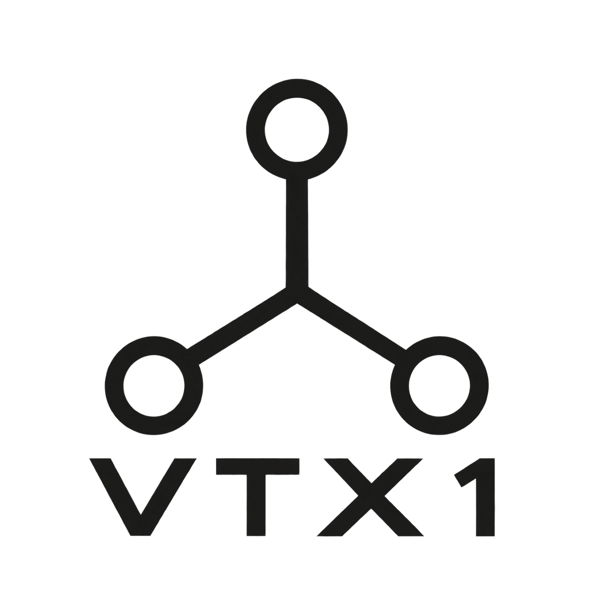

<p align="center">
  
</p>

# VTX1 Ternary SoC

A personal project: a balanced-ternary System-on-Chip with a complete, verified code-to-silicon chain. The same trit-encoded binary assembles, runs in the ISA simulator, executes on the CPU RTL, and executes through the full SoC — and all of them agree.

```
$ task test-soc
SoC says: "Hello, VTX1!"
Cycles: 911  Retired: 93
PASS: VTX1 SoC executed hello_world end to end
```

---

## Table of Contents

- [Project Description](#project-description)
- [Architecture](#architecture)
- [Toolchain](#toolchain)
- [Project Status](#project-status)
- [Prerequisites](#prerequisites)
- [Quick Start](#quick-start)
- [Project Layout](#project-layout)
- [Documentation](#documentation)
- [Build, Develop and Contribute](#build-develop-and-contribute)
- [License](#license)
- [Contact](#contact)

---

## Project Description

VTX1 explores what a computer looks like when its number system is balanced ternary (trits: −1, 0, +1). The machine is binary on the outside — ordinary buses, memories, and I/O carry trits as 2-bit pairs — and ternary on the inside: the instruction set, registers, arithmetic, and addressing are all native balanced ternary.

That buys properties binary machines have to work for:

- **Negation is free** (tritwise flip, no carry) — subtraction is addition
- **Multiplication is natively Booth-encoded** — multiplier digits are already {−1, 0, +1}
- **Truncation rounds to nearest** — lower error accumulation in MAC chains
- **Symmetric number range** — no `abs(INT_MIN)` overflow class of bugs
- **Three-way compare is native** — one `CMP` yields the full sign (−1/0/+1)
- **Signed-by-construction** — "unsigned" doesn't exist, so neither do its bugs

## Architecture

- **18-trit machine words** (36 bits at 2 bits/trit), word-addressed memory
- **Trit-native ISA**: 4-trit opcodes (69 assigned, 12 reserved of the 3⁴ space), balanced-ternary immediates and PC-relative branches, a TZ zero register, negative addresses reserved for MMIO. The all-zero-trit word is NOP.
- **VLIW bundles**: 3 operation words = 54 trits = 108 bits, with assembler-enforced packing rules
- **No microcode**: hardwired control plus dedicated multi-cycle units (divider, vector reductions). Transcendentals are software over the ternary primitives.
- **Single source of truth**: the entire ISA lives in [`src/assembler/isa/isa.go`](src/assembler/isa/isa.go); the Verilog constants and decode tables are generated from it, so the toolchain and the RTL cannot drift apart.

The RTL (`src/`) is plain Verilog, simulated with Icarus: `vtx1_decoder` (combinational trit-native decoder), `vtx1_core` (multi-cycle CPU with a bus-handshake memory port), and `vtx1_soc` (the full chip: bus matrix, memory controller, cache, UART/SPI/I2C/GPIO/DMA, debug/JTAG, external SRAM pins).

## Toolchain

Written in Go, under `src/assembler/`:

- **`vtxasm`** — assembler with a preprocessor (`.INCLUDE`, parameterized `.MACRO`), VLIW packing validation (resource conflicts are errors, read-after-write hazards are warnings), and output as raw words, VLIW bundles, Intel HEX, a trit-level `objdump` disassembly, or `$readmemh` memory images
- **`vtxsim`** — ISA-level simulator with balanced-ternary semantics; reports dynamic instruction counts, memory traffic, and branch behavior for architecture evaluation
- **Benchmarks** (`src/assembler/benchmarks/`) — Tier A kernels with machine-verified results on both sides of the comparison: VTX1 vs an RV32IM control core (`rvsim`, same instrumentation). Headline: **−34%** dynamic instructions on three-valued sign arithmetic, **−30%** on absolute differences, **−16%** on dot product, parity on the neutral control-flow kernel — [full table and caveats](src/assembler/benchmarks/README.md)

The chain is kept honest by cross-checks at every seam: the Verilog decoder is tested against real assembler output word by word, and the RTL core's retired-instruction count must match the simulator exactly.

## Project Status

**✅ Working today:**
- Trit-native ISA, single-sourced, with generated Verilog headers
- Assembler, ISA simulator, and benchmark suite (all Go-tested)
- CPU RTL executing programs, cross-checked against the simulator
- Full SoC executing programs through the bus matrix, memory controller, and external SRAM pins
- Ternary-vs-binary architecture comparison (VTX1 vs RV32IM, identical instrumentation)
- Build and test automation with Taskfile; Yosys synthesis flow

**🚧 In progress:**
- Performance: tightly-coupled instruction RAM, parallel VLIW bundle issue (SoC CPI is ~9.8 today)
- Stack ABI (PUSH/POP), iterative divider FSM for synthesis

**🔮 Planned:**
- SPICE-characterized ternary cells on SkyWater 130nm device models (circuit-level evaluation)
- Ternary-weight MAC/matrix accelerator (weights in {−1, 0, +1} need no multipliers)
- OpenROAD/OpenLane place & route; FPGA demonstrator

## Prerequisites

- [Go](https://go.dev/) 1.24+ (assembler, simulator, ISA generator)
- [Icarus Verilog](https://bleyer.org/icarus/) (RTL simulation)
- [Task](https://taskfile.dev/) (build automation)
- Optional: Java (only to regenerate the ANTLR parser), [Yosys](https://yosyshq.net/yosys/) (synthesis), GTKWave (waveforms)

## Quick Start

```sh
git clone https://github.com/itworks99/vtx1.git
cd vtx1

task test-all      # decoder vs assembler output, hello_world on the CPU RTL,
                   # hello_world through the full SoC

task bench         # Tier A benchmarks in the ISA simulator
task sim-hello     # assemble + run hello_world in vtxsim
```

Assemble and inspect a program by hand:

```sh
cd src/assembler && go build -o vtxasm . && cd ../..
src/assembler/vtxasm -f objdump -o hello.dump src/assembler/examples/hello_world.asm
```

```
word      trits               disassembly
--------  ------------------  -----------
00000000  -+0+---00+-0-0-+-0  LEA T0, 0x100E
00000001  -+0+--000++-+-0++-  LEA T1, 0x2000
00000004  0-0--0-+--00000+-0  BEQ T3, 0, PC+6
00000006  ---0------+000000+  ADD T0, T0, 1
```

Toolchain unit and execution tests:

```sh
cd src/assembler && go test ./...
```

## Project Layout

```
src/assembler/        Go toolchain: assembler, ISA definition, simulator, benchmarks
src/assembler/isa/    THE ISA - single source of truth + Verilog header generator
src/cpu/              vtx1_decoder.v, vtx1_core.v (trit-native, no microcode)
src/common/           ternary arithmetic/logic + generated ISA headers
src/memory/ src/cache/ src/system/   memory controller, cache, bus matrix, peripherals
src/vtx1_soc.v        the SoC top level
src/testbench/        decoder, core, and full-SoC testbenches
docs/                 architecture documentation (AsciiDoc)
```

## Documentation

- [Architecture Specification](docs/Architecture.adoc) ([PDF](release/vtx1-architecture.pdf))
- [Instruction encoding](src/assembler/docs/vliw_encoding.adoc) — the trit-native format reference
- [Benchmark methodology and results](src/assembler/benchmarks/README.md)
- [`src/assembler/todo.md`](src/assembler/todo.md) — detailed design notes and decision log

## Build, Develop and Contribute

Contributions are welcome! See [CONTRIBUTE.MD](CONTRIBUTE.MD) for guidelines.

## License

Copyright 2025 K. Vanyushov

Licensed under the Apache License, Version 2.0. See [LICENSE](LICENSE) for details.

## Contact

For questions or feedback, please open an issue or contact [@itworks99](https://github.com/itworks99) on GitHub.
